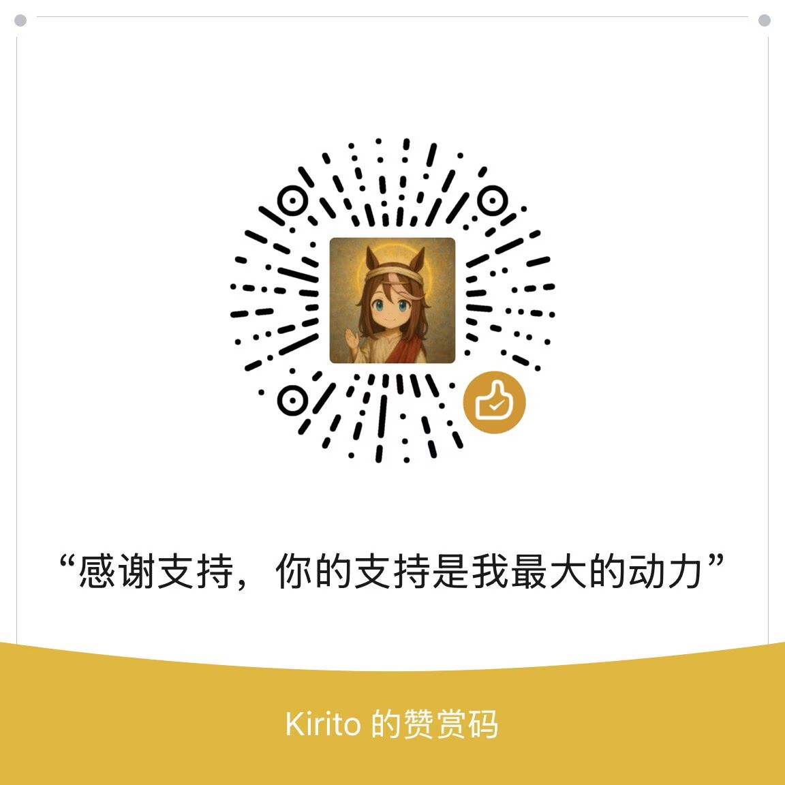

# Ku Programming Language

[简体中文](README.md) · [Website](https://ku-lang.com/) · [English Docs](https://ku-lang.com/en/docs/getting-started/) · [中文文档](https://ku-lang.com/zh-cn/docs/getting-started/) · [Install Ku](https://ku-lang.com/en/docs/install/)

[Documentation source](web/src/content/docs/en/docs)

Ku is an experimental programming language with an interpreter, static checking, native C compilation, a standard library, and a VS Code extension. The current formal release is **0.0.20**, licensed under [Apache-2.0](LICENSE); see [NOTICE](NOTICE) for attribution.

This release brings together adopted HTTP, Task, JSON and PostgreSQL fixes, CLI/SDK delivery improvements and VS Code extension repairs. The language and runtime remain under development; a formal release does not establish universal production readiness or completion of all performance targets. Read the [release notes](docs/v0.0.20.en.md) and [known limitations](docs/v0.0.20-known-issues.en.md).

## Install and run

Choose the matching OS and architecture from [v0.0.20 Release](https://github.com/fengyanweb/ku/releases/tag/v0.0.20), verify the supplied `SHA256SUMS`, extract the archive, and add its directory to `PATH`. Keep the accompanying libraries and metadata with `ku` (`ku.exe` on Windows).

```sh
ku -v
ku create HelloWorld
cd HelloWorld
ku check
ku run
```

```ku
fn main() {
    println("Hello, Ku!")
}
```

From this repository:

```sh
ku run examples/hello.ku
ku check examples/json.ku
ku build --backend c --profile release examples/hello.ku -o hello
```

Backend coverage differs. Database drivers need native output and their client libraries. Multi-loop HTTP and owner Task execution refer to the native C backend; a successful `ku check` does not prove that every backend supports a program.

## Documentation

- [Guides and library reference](web/src/content/docs/en/docs): language syntax, ownership, errors, HTTP, Task, JSON, time, databases, and platform limits.
- [Runnable examples](examples), [syntax contract](docs/syntax.md), and [semantic contract](docs/semantics.md).
- [Task semantics and backend coverage](docs/concurrency.md).
- [Network and database protocols](docs/protocol-foundation.md): connection options, TLS, and verified platform support.
- [VS Code extension](editors/vscode-ku/README.md).
- [Historical 0.0.19 seven-language fixed-load comparison](docs/performance-v0.0.19.en.md).
- [Release notes](docs/v0.0.20.en.md) and [known limitations](docs/v0.0.20-known-issues.en.md).

Use `ku --help` and subcommand help for the installed version's options. Common commands include `check`, `run`, `build`, `ir`, `package`, `service`, and `supervise`.

## Build from source

Source builds are pinned to Rust 1.99.1. Installed `ku run` and `ku check` do not require Rust. Default Runner `ku build` requires a compiler with the exact identity recorded by its SDK and a system linker; a precompiled rlib is not portable across arbitrary rustc versions. Native C output needs a supported C compiler and the native libraries used by the program. See [CLI and SDK compatibility](docs/cli-runtime-bundle.en.md).

```sh
cargo +1.99.1 build --locked --release
./target/release/ku -v
./target/release/ku run examples/hello.ku
```

On Windows, use `target\release\ku.exe`.

## History

[0.0.19](docs/v0.0.19.md), [0.0.18](docs/v0.0.18.md), its [historical revision](docs/v0.0.18-r1.md), [0.0.17](docs/v0.0.17.md), and [0.0.16](docs/v0.0.16.md) remain available with their original release identities. Historical performance results apply only to their recorded commit, workload, platform, and limits.

## Feedback

Report problems through [GitHub Issues](https://github.com/fengyanweb/ku/issues) or email [kagura.gc@qq.com](mailto:kagura.gc@qq.com). Include the Ku version, operating system, a minimal reproducer, and error output.

## Support Ku

You can support Ku development and documentation through [Afdian](https://afdian.com/a/ku-lang) or WeChat. Support is voluntary and does not affect access to Ku.

<a href="web/public/images/wechat-donation.png"></a>
